

e-commerce

I worked at EyeEm for 2+ years on the browser-based platform and the Webflow marketing site. When the team shrank, I partnered with the PM to hire new product designers, reviewing portfolios and interviewing candidates together.

  

    
 Product Designer

    
 Berlin, Hybrid

    
 2021 - 2023

  

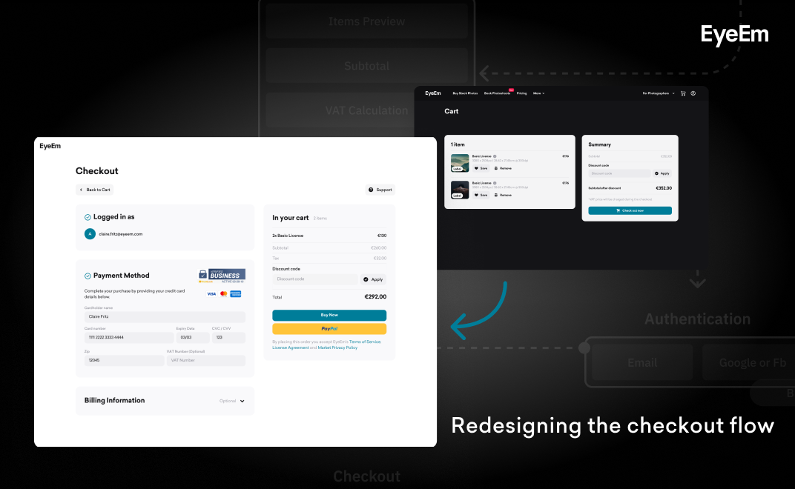

### About EyeEm

**EyeEm** is a photography community and marketplace that facilitates connections between creators and prominent brands to source original and on-brand content.

### My role at EyeEm

I was one of the designers in the Product team, working on the browser-based platform. I **led the Cart & Checkout redesign**, working with a PM, the Data team and a front-end developer, and I maintained EyeEm's **Webflow** marketing site.

<strong>Project status:</strong> the redesign was in its final review before development when EyeEm went through insolvency, so it never shipped. I'm sharing it for the process: diagnosing drop-offs with data, prioritising quick wins and designing within an existing system.

### Reducing friction in the purchase journey

The redesign started from **funnel data** prepared by the Data team and shared by the PM, which showed where users were dropping off between the Cart and a completed purchase.

From there, we identified **pain points**, formed hypotheses and proposed improvements, including background color inconsistencies, premature tax calculations and SSO issues for logged-out users. We also consulted the legal team on changes like pre-saving billing and payment details.

The company was under pressure, so we needed to move fast and effectively. We prioritised by **impact vs. effort**, favouring changes that were also **low effort for front-end development**. I ran **fresh eyes sessions** with the two other product designers to review the work, and the final design was a **consensus between the PM, Data, Front-End and me**, with input from several areas of the company.

<a href="images/eyeem-user-flow.png" class="lightbox">
  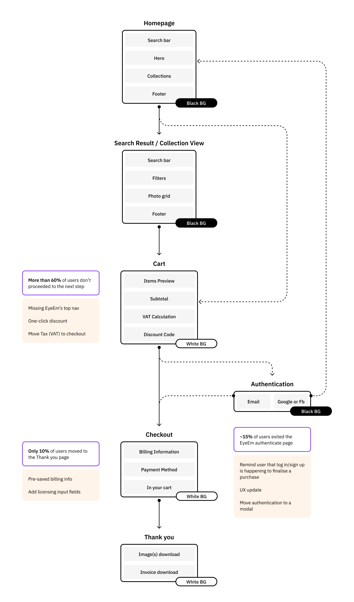
</a>

Identifying Data take-aways and UI pain points on the Cart & Checkout flow

<a href="images/eyeem-user-flow-figma-study.png" class="lightbox">
  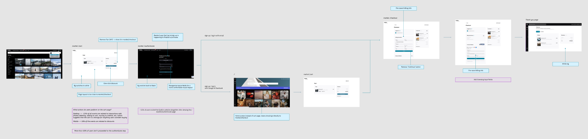
</a>

Screenshot from the user flow analysis in Figma

### UX Exploration

#### Cart Page

<a href="images/eyeem-ux-cart.png" class="lightbox">
  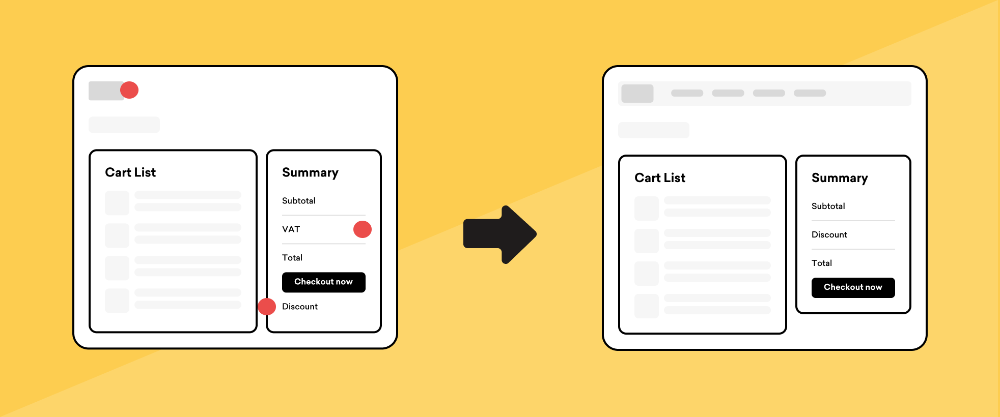
</a>

With a <strong>60% drop-off rate</strong> among <strong>logged-out users</strong> before reaching the authentication step, we wanted to identify the main pain points on the Cart page.

##### Top Navigation

The Cart page **lacked EyeEm's familiar top navigation**, which could make users feel as though they’d left our site, potentially impacting trust. We hypothesized that reintroducing the top navigation might improve user confidence and retention.

##### VAT Calculations

VAT calculations were appearing **too early in the cart flow**. As users added more items, the displayed total rose significantly, which might discourage them. We considered moving VAT calculations closer to the payment step to present a more approachable total earlier in the process.

##### Dark Theme vs. Light Theme

A previous designer's audit had already flagged parts of this flow as outdated. Looking at the screens in depth, we found that the Cart had **no top navigation** and used a **light background**, which could make users feel they had left EyeEm. **Benchmarking** how competitors handled their carts supported this hypothesis.

Switching to EyeEm's **dark theme** was also a low-effort quick win: it was our main theme, and all the components already existed in the **design system and UI kit**.

##### Introducing more payment methods: Long term goals

To enhance convenience, we considered adding **more one-click payment options**, such as PayPal, Apple Pay and Google Pay, in future iterations.

  

    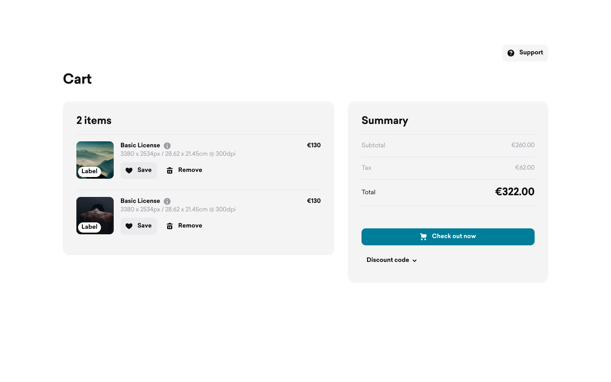
    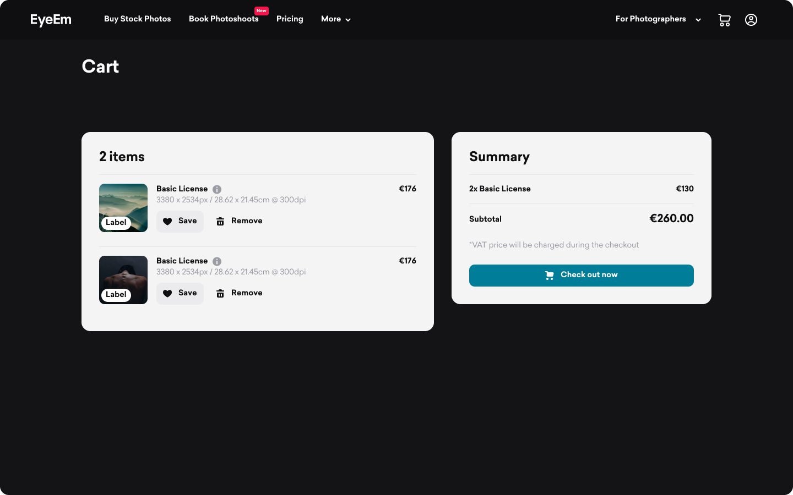
  

  

    <button class="btn-before active">Before</button>
    <button class="btn-after">After</button>
  

#### Authentication for logged out users

<a href="images/eyeem-ux-auth.png" class="lightbox">
  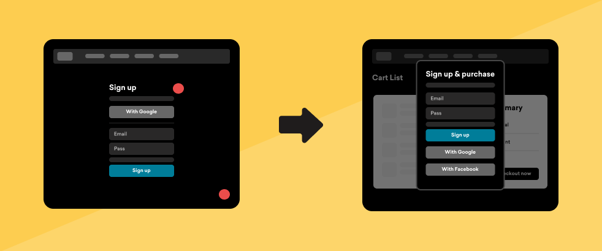
</a>

<strong>Approximately 15% of users were dropping off</strong> on the Authentication screen. We required logged-out users to log in or create an account before proceeding, but this interruption often disrupted their flow.

##### Authentication Modal

To create a more seamless experience, we moved authentication to a modal, **allowing users to keep their Cart in view** while logging in or signing up.

##### UX writing

To keep users engaged, we explored updating our UX copy with **clearer instructions**, gently reminding users they were in the middle of a purchase.

##### Guest Checkout: Long-term goals

We also discussed the potential for a Guest Checkout, allowing users to **skip authentication until later stages**. While this feature wasn’t implemented in this iteration, it remains a consideration for the future.

  

    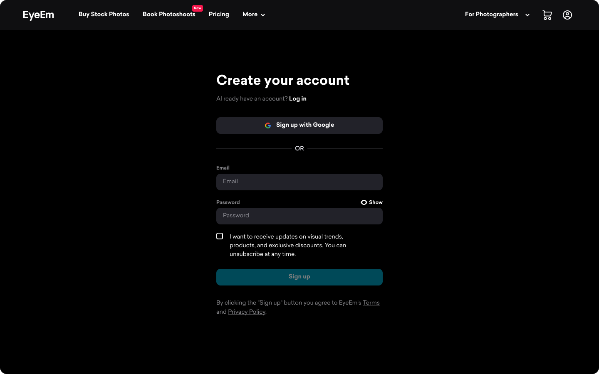
    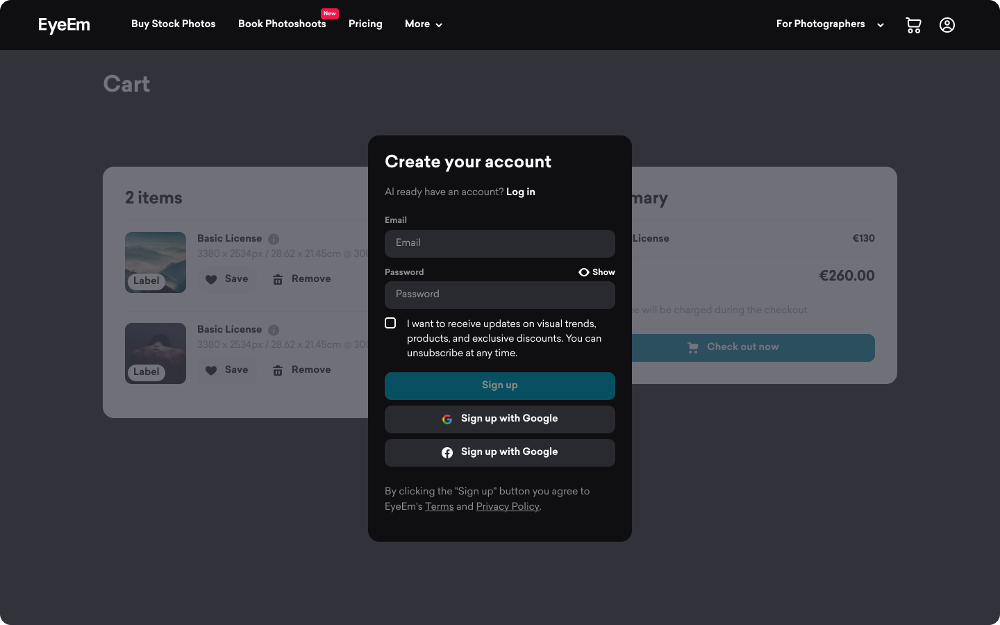
  

  

    <button class="btn-before active">Before</button>
    <button class="btn-after">After</button>
  

#### Checkout Page

<a href="images/eyeem-ux-checkout.png" class="lightbox">
  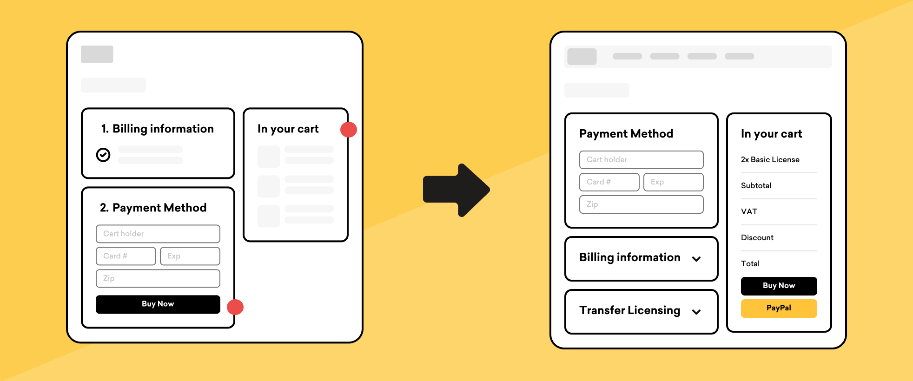
</a>

<strong>Only 10% of users</strong> who reached the Checkout page <strong>completed their purchase</strong>, highlighting a need to streamline this stage. We aimed to compress the steps required and reduce user interactions.

##### Cart Preview & Buy Now button

Previously, the "Buy Now" action was hidden in the second step and often inaccessible with longer Cart lists. We **standardized the Cart preview** by grouping items by license type, which kept the "Buy Now" option in view, encouraging **quicker decision-making**.

##### Transfer Licensing

Many of our users—often designers or agencies buying for clients—needed an option to transfer licensing directly to their clients. Previously, they had to call Support to complete this transaction. By adding this feature to the redesign, we **streamlined the process** and responded to a frequent user need.

##### Pre-save payment and billing information: Long term goals

To streamline the purchase process, we considered **pre-saving user data**, such as cart details and billing information. However, due to capacity and alignment with the legal team, we decided to prioritize this feature for future iterations

  

    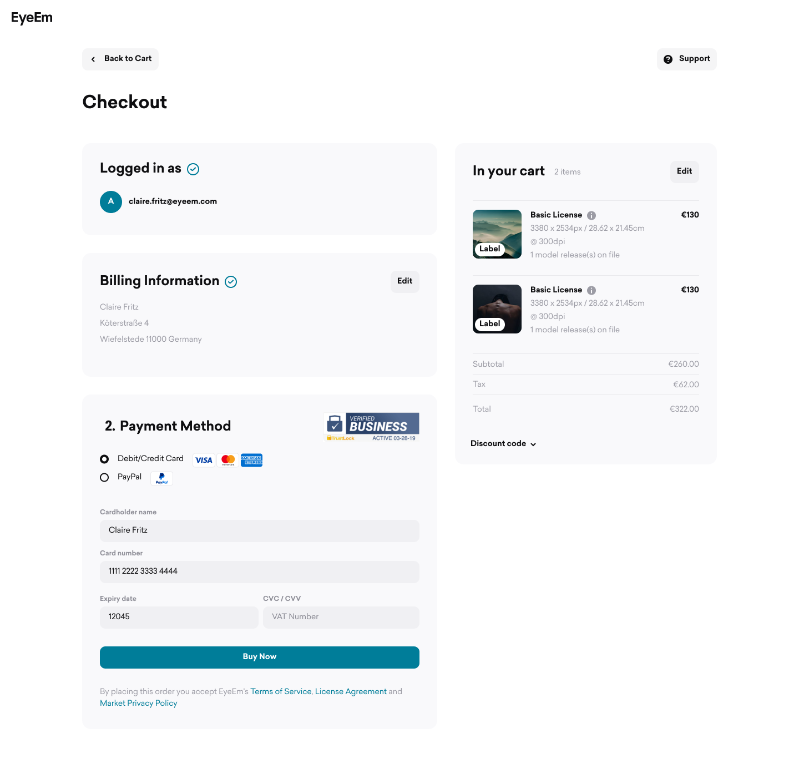
    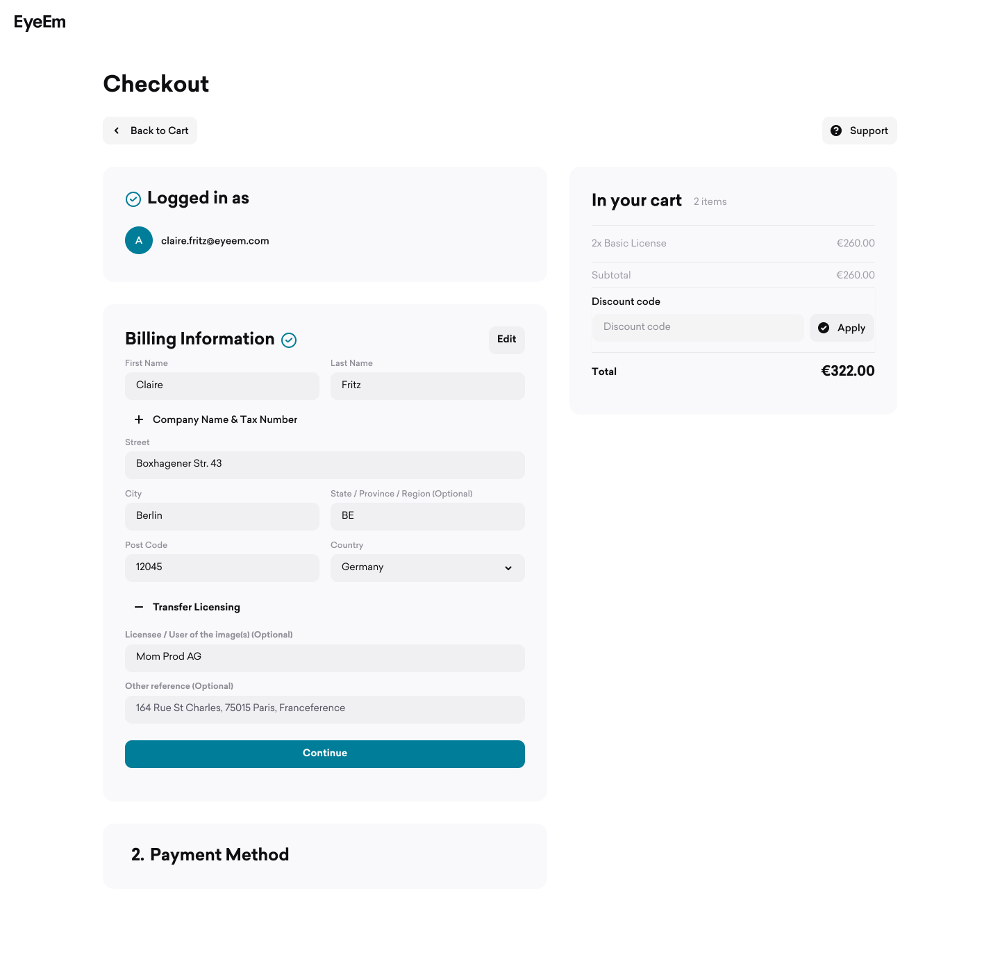
  

  

    <button class="btn-before active">Before</button>
    <button class="btn-after">After</button>
  

#### Thank you Page

<a href="images/eyeem-ux-thank-you.png" class="lightbox">
  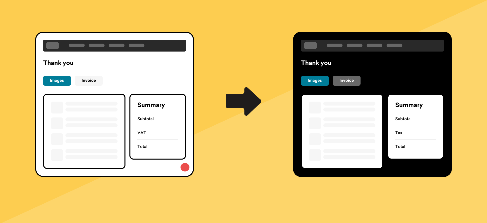
</a>

##### Dark Theme Consistency

To maintain a cohesive user experience, we applied EyeEm’s dark theme to the Thank You page as well. This ensured visual continuity throughout the checkout journey, reinforcing a sense of familiarity and completion. Introducing a light theme at this final stage could have disrupted the flow and made the experience feel disconnected from the rest of the platform.

  

    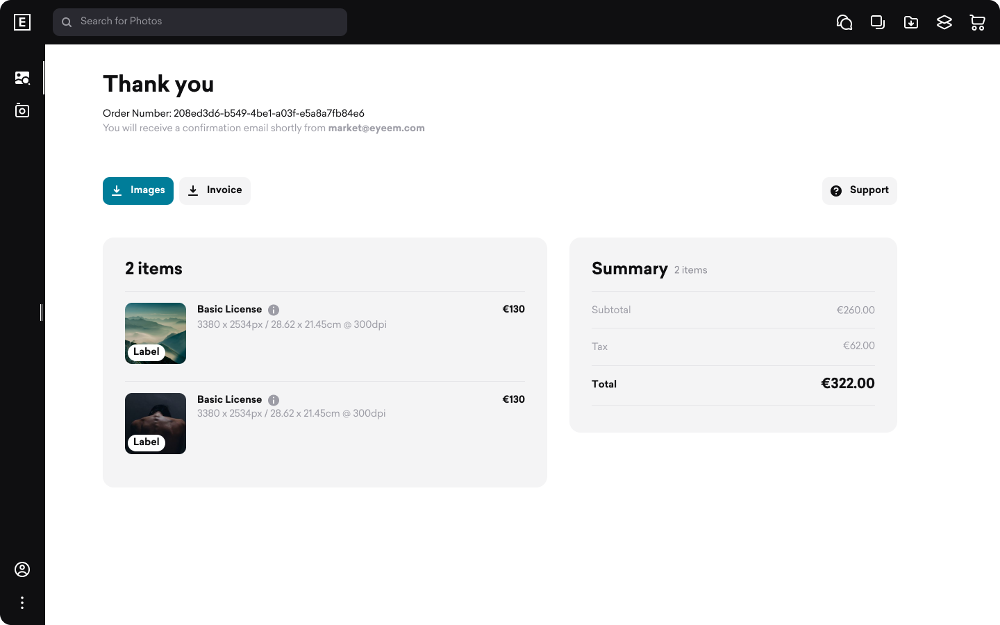
    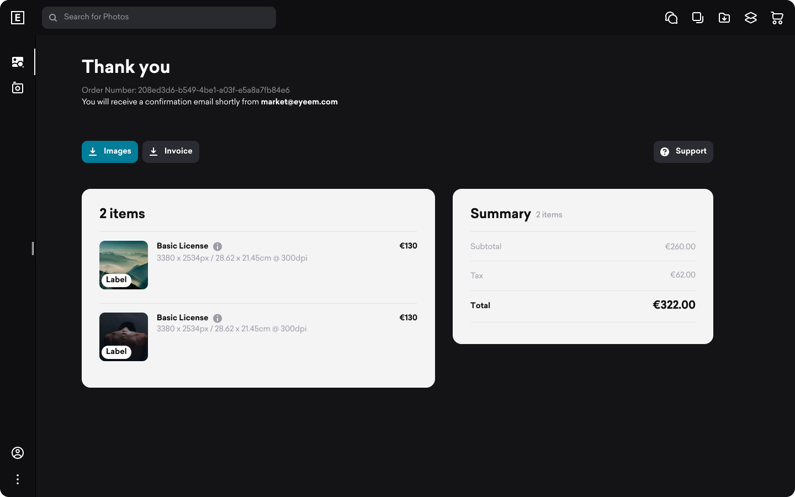
  

  

    <button class="btn-before active">Before</button>
    <button class="btn-after">After</button>
  

### EyeEm's Web presence

<a href="https://eyeem.com" target="_blank">EyeEm.com </a> combines the flexibility of **Webflow** with the capabilities of front-end development, giving designers complete control over the UI and behavior of some areas of the website. I maintained various site areas and launched around **four landing pages per quarter** for marketing campaigns, collaborating with the Marketing and Innovation teams. I was responsible for ideation, design, implementation, and final release of these projects.

Here are some live examples:

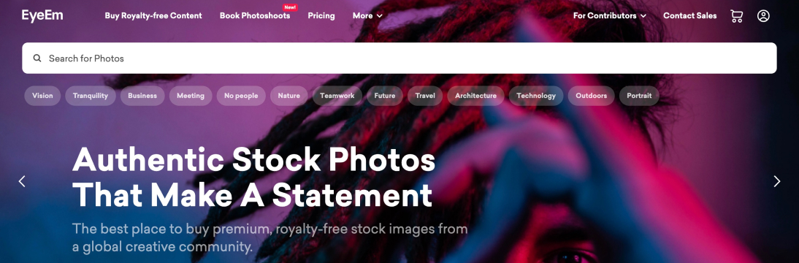
<a href="https://eyeem.com" target="_blank">eyeem.com</a>

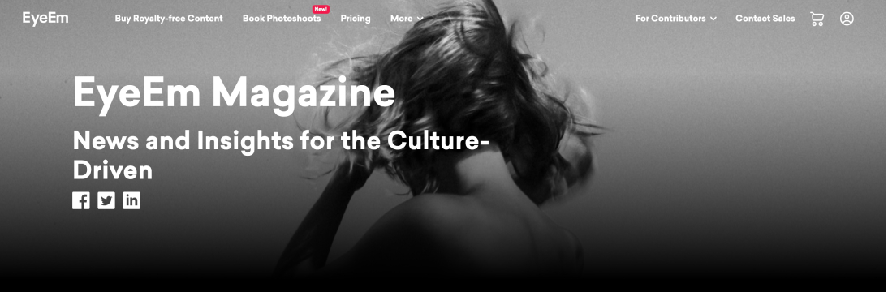
<a href="https://www.eyeem.com/magazine" target="_blank">eyeem.com/magazine</a>

<a href="https://www.eyeem.com/awards" target="_blank">eyeem.com/awards</a>

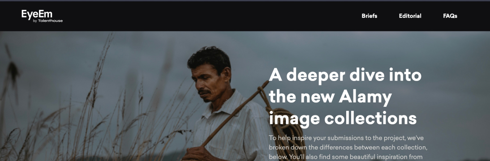
<a href="https://creativetrends.eyeem.com/" target="_blank">creativetrends.eyeem.com</a>

### Learnings

- **Data makes a problem concrete.** The funnel numbers turned a project with many opinions into a shared diagnosis, and helped align the PM, Data and Front-End on what to fix first.
- **Quick wins live inside the system.** Reusing the dark theme and existing components made improvements cheap to build when speed mattered most.
- **Define success at the start.** We had the baseline funnel data, so measuring the impact after launch would have been straightforward, but we never agreed on targets. Today I'd set them at kick-off.

