

e-learning

My role at Mondly involved a variety of tasks, collaborating closely with designers, marketers, User Acquisition and Growth specialists, website developers, and data scientists to consolidate Mondly's rebrand across all touchpoints.

  

      
 Senior Product Designer

      
 Fully remote

      
  2023 - 2024

  

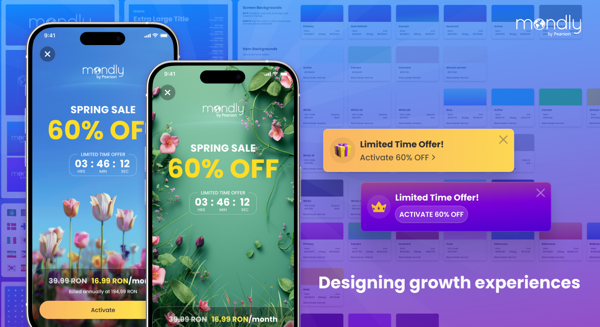

### About Mondly

**Mondly** is a language learning app that aims to make language learning fun and easy through technological innovation and multiple language combinations.

On 2022 Mondly got acquired by Pearson, giving the Product team a chance for a big redesign of Mondly's platform and web presence.

### My Role at Mondly

During my stay at Mondly, making **A/B tests** about the performance of the Old vs. the New Design was important to validate with data the development of the rebrand and plan the marketing strategies for this design transition.

Before I joined the team, the product designers put in place a detailed **design system** that served as base for all the future assets we developed on the way. I collaborated closely with one of my colleagues on the creation of a **style guide** in Notion, were we documented the details of the New Mondly Brand and its usage.

<a href="images/styleguide-components.png" class="lightbox">
  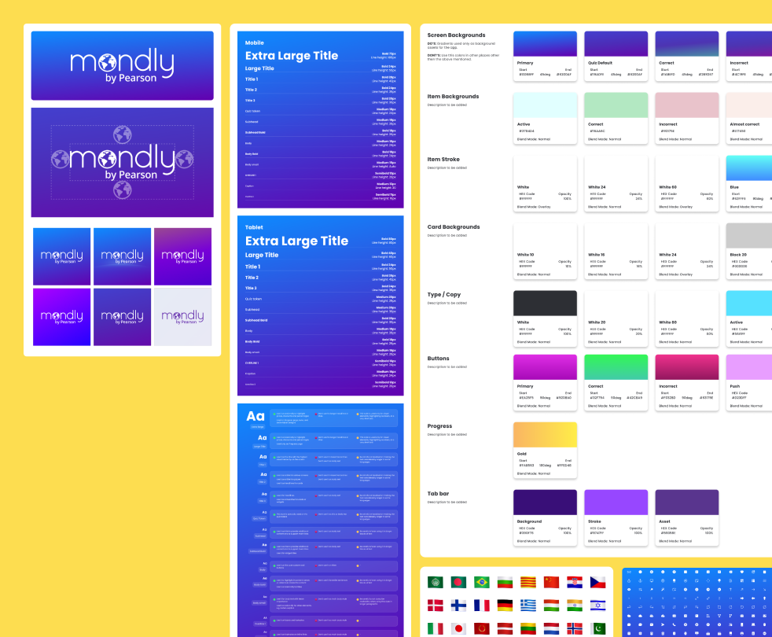
</a>

View of some of the components built for the Styleguide in Figma

### Mondly Web & Marketing

With a major rebranding underway, we created brand guidelines based on our design system that we could extend into marketing materials. We conducted a series of **A/B tests** to compare the performance of the **new design versus the old one**, ensuring a positive impact on user engagement.

#### Redesigned Offer page

For this project, we adapted the app’s design system for use on a marketing landing page for the first time. This laid the foundation for a **scalable design system** tailored to **web marketing materials**, evolving with the team’s needs. It also enabled us to expand the style guide specifically for marketing designers, who would use it in areas such as social media campaign ideation.

  

    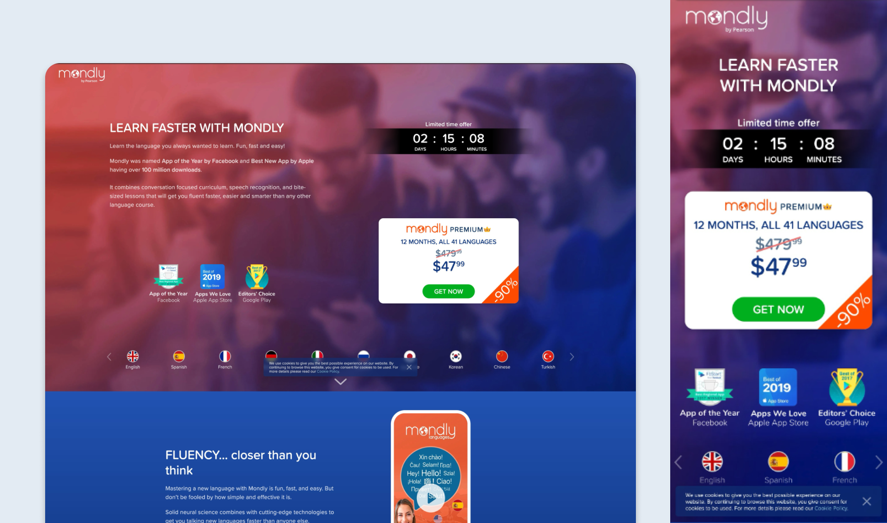
    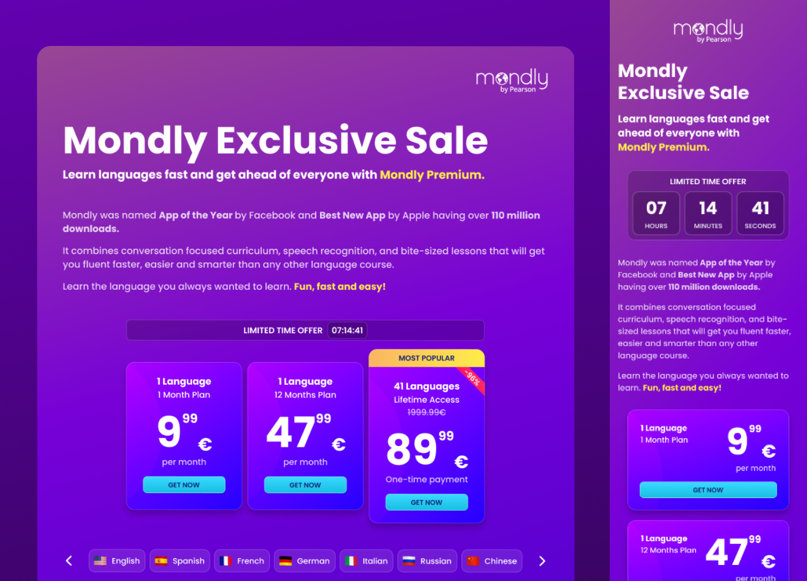
  

  

    <button class="btn-before">Before</button>
    <button class="btn-after active">After</button>
  

Before: Mondly's old Offer page design. After: Redesigned Offer Page on iPad&nbsp;mini and iPhone&nbsp;SE

 The redesigned Offer page resulted in an increase in <strong>average time on page</strong> and a lower <strong>bounce rate</strong> compared to the original control version.

#### App Store & Google Play images

In order to test the impact of the rebranding on the Stores, we initiated a project to extend the new brand to these images. The light mode was introduced after benchmarking research showed competitors favoring light backgrounds in their App Store images. We organized several **Design Team workshops** to develop a light version of our new brand, allowing us to include it in the **A/B testing**.

 <a href="images/app-store-images-dark.png" class="lightbox">
   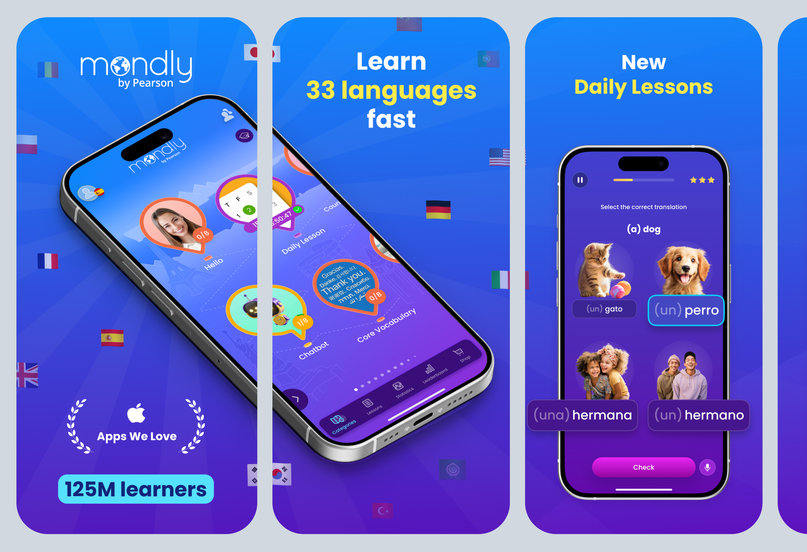
 </a>

 <a href="images/app-store-images-light.png" class="lightbox">
   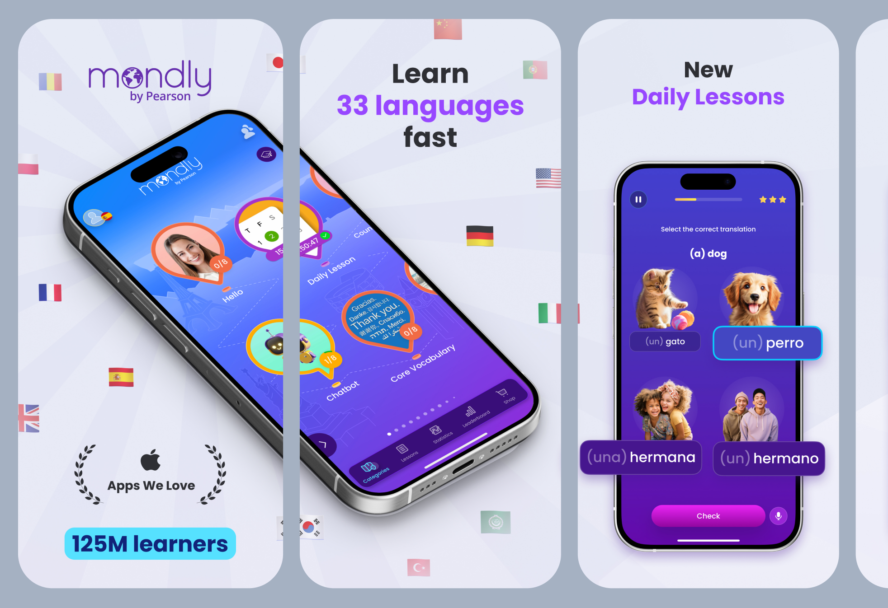
 </a>

Screenshots of the dark and light versions of the App Store images for iPhone X

 Data showed a <strong>nearly 3% increase in App Store downloads</strong> with <strong>Mondly's Light theme</strong> version compared to the control and dark theme variants. With this percentage we met our OKRs for Q1 2024

#### Balancing Growth with Brand Experience

A recurring challenge at Mondly was **balancing short-term acquisition goals with the long-term product experience**.

The User Acquisition team often looked to high-converting apps like **Temu** or **AliExpress** for inspiration. These apps rely on urgency, aggressive promotions and visually dense interfaces. The patterns clearly worked for them, but we in the Product Design team felt they could **hurt trust in a learning product** and didn't fit Mondly's brand.

Instead of rejecting the requests, I looked at _why_ those patterns convert: **urgency, a clear offer and high visibility**. I then designed Limited Time Offer banners that used those principles within Mondly's design system.

<a href="images/mondly-lto-process.png" class="lightbox">
  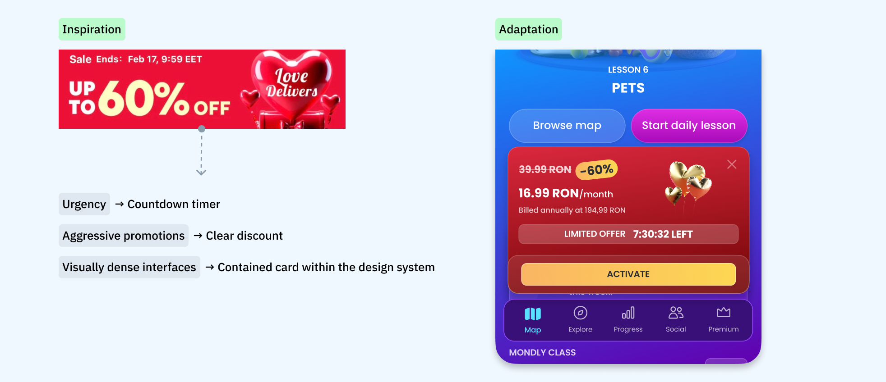
</a>

From inspiration to adaptation: keeping the conversion principles, leaving out the visual density.

For the **Valentine's Day campaign**, this meant taking the energy of high-conversion promotions and translating it into Mondly's visual language. It took **several rounds of feedback** with Marketing, Growth and User Acquisition. I explored different versions, explained the trade-offs of each, kept what supported their goals and adjusted what compromised the brand.

<a href="images/mondly-lto-versions.png" class="lightbox">
  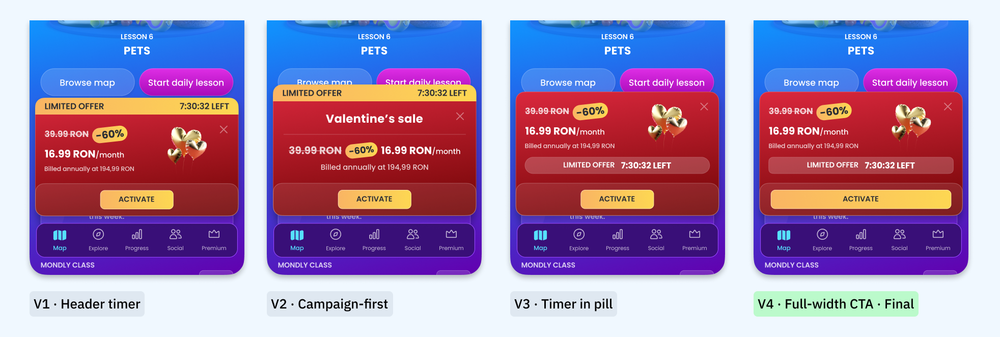
</a>

Explorations for the Valentine's banner: timer in a header vs. inside the card, offer-first vs. campaign-first, and the weight of the CTA. The final kept the timer inside the card with a full-width CTA.

The same approach shaped the **Limited Time Offer banners** that appeared in the app outside seasonal campaigns. Here, instead of debating which direction was right, we tested **three variants in an A/B/C test** and let user behaviour

#### Seasonal Campaigns

Seasonal campaigns such as Spring Sale, Valentine’s Day and Black Friday were one of Mondly’s **key growth initiatives**. They encouraged free users to upgrade to Premium through limited-time offers, and they followed a consistent in-app conversion flow.

<a href="images/seasonal-campaigns-user-flow.png" class="lightbox">
  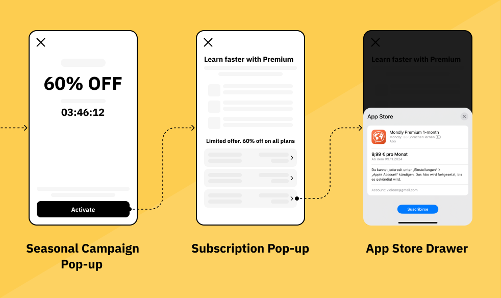
</a>

In-app conversion flow for seasonal campaigns.

##### The Challenge

3D illustrations were a core part of Mondly’s visual identity. Each campaign needed a new illustration from an external 3D artist, followed by several rounds of stakeholder review.

The quality was excellent, but as campaigns became more frequent, this process **slowed down launches and made it hard to get new creative directions approved**.

<a href="images/seasonal-campaigns-old.png" class="lightbox"> 
  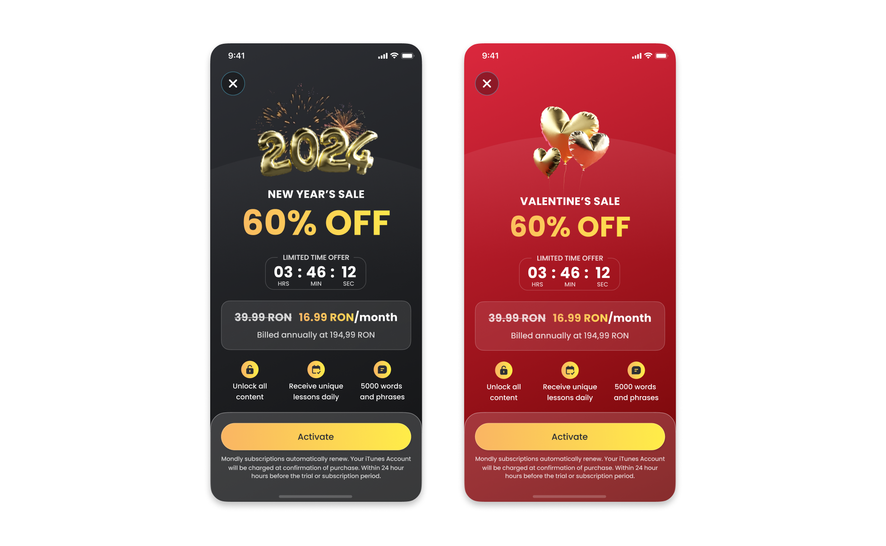 
</a> 

The previous workflow depended on a bespoke 3D illustration for every campaign.

##### Rethinking the Approach

While designing the Spring Campaign, I discussed the workflow with the Design Lead. We realised the bottleneck wasn’t the layout, it was the dependency on a new 3D asset every time.

So we changed the question:

> **How can we keep Mondly’s 3D visual identity while making campaigns faster to produce and easier to align on with stakeholders?**

I redesigned the campaign layout so the 3D look came from an **AI-generated background** instead of a bespoke illustration. The designer in charge could now produce the final asset in-house, without waiting on an external partner, while the campaign still felt unmistakably Mondly.

<a href="images/seasonal-campaigns-redesign.png" class="lightbox">
 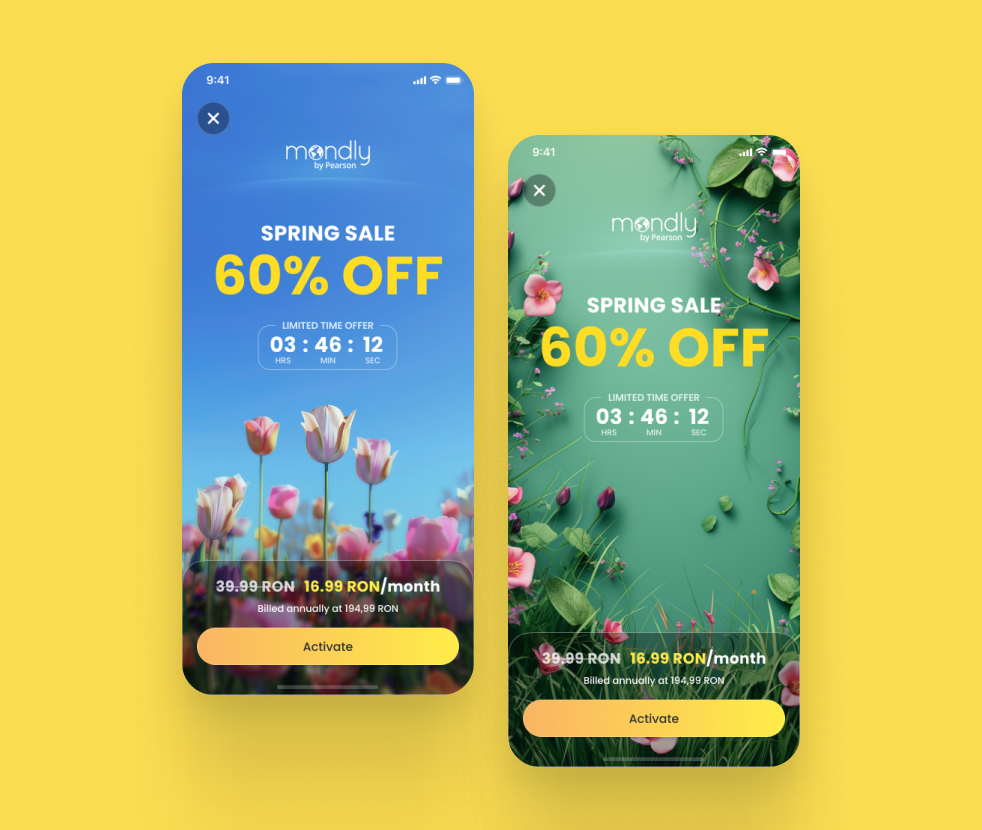 
</a> 

Spring Campaign redesign: an AI-assisted background keeps the 3D look without a bespoke illustration.

##### Validation

We aligned with stakeholders to test **two variants with different backgrounds against the original campaign** in an **A/B/C test**.

<a href="images/seasonal-campaigns-test-result.png" class="lightbox">
 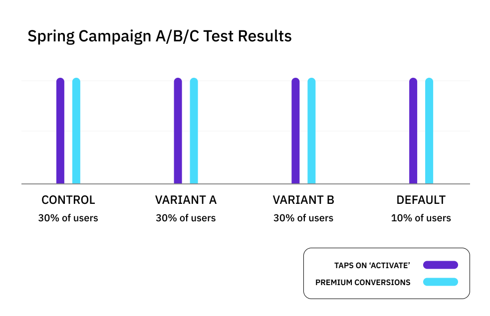 
</a>

 <strong>Variant B</strong> performed best, <strong>with 7% more Activate taps than the original campaign</strong>. The new layout showed that faster, in-house production could keep the brand experience and improve engagement at the same time.  <strong>The new layout became the template for the following seasonal campaigns</strong>, so each new promotion could be produced in-house and tested without commissioning new 3D artwork.

### Marketing Campaigns

One major ongoing marketing campaign involved creating an onboarding flow with a questionnaire that guided users to a payment screen. I was responsible for the design and UX of this flow. The biggest challenge was developing a style that seamlessly blended elements of both the old and new Mondly branding.

<a href="images/w2w-screens.png" class="lightbox">
  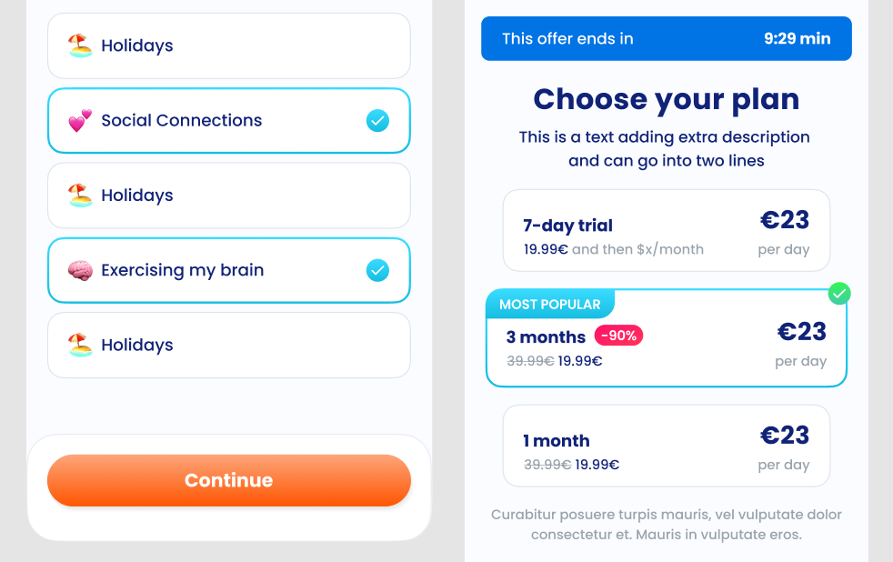
</a>

<a href="images/w2w-components.png" class="lightbox">
  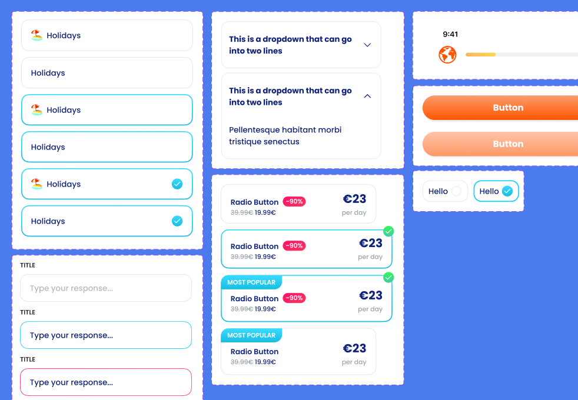
</a>

Figma screenshot from the W2W campaing mockups and components in Figma

